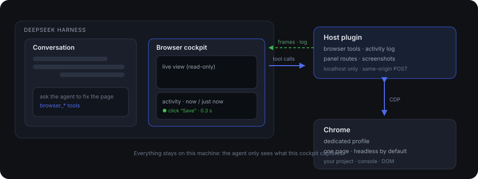

# Browser cockpit

[](https://github.com/deepseek-ai/deepseek-harness)

**A live Chrome cockpit for [DeepSeek Harness](https://github.com/deepseek-ai/deepseek-harness) agents.**
The agent pilots a real browser; you watch the same page — and every step it takes — right beside the conversation.

[中文说明](README.zh.md) · [Architecture](docs/architecture.svg)

## Why

Agents are good at reading source code and bad at seeing a running interface. This plugin gives the agent its own Chrome page to open, read, click, type in, resize, and screenshot, and it gives you a cockpit for that page: live frames in the right sidebar, a per-step activity log with thumbnails, and a compact "what is it doing now" pill above the composer. No more copying screenshots back and forth.

## What you get

- **13 browser tools** for the agent: open, snapshot, wait, handle dialog, click, type, key, scroll, eval, console, screenshot, resize, close.
- **Live view** in the right sidebar, side by side with the conversation, refreshed about every 1.3 seconds.
- **Activity log** — every action with its time, duration, result, page, new page errors, and a thumbnail you can enlarge.
- **Auto-open**: the right tab appears on the agent's first browser action in a session; close it and a status pill takes over.
- **Status pill** above the composer: `Agent now: click “Save”` / `Just now: screenshot` with a thumbnail and a *View* button.
- **Session-aware**: the right tab and pill show this session's actions plus your own panel actions; the left panel keeps the full history.
- **Real input**: clicks and typing are browser-level events, so React state, focus, validation, and hover behave like a person.
- **Local only**: dedicated Chrome profile, loopback-only panel routes, no telemetry, no external services.

## How it works



The Host half runs a dedicated Chrome and exposes `browser_*` tools plus loopback JSON routes (`state`, `activity`, `frame.jpg`, `thumb`, `action`). The Client half is a small React panel that polls those routes: it registers the left-sidebar entry, the right-sidebar tab, the session-header icon, and the composer pill. Screenshots from tools become durable attachments, so the agent sees the image in the conversation.

## Requirements

- DeepSeek Harness `0.2.2-rc.x` (the release that ships the client slot and sidebar-tab APIs used here).
- The DSH Web GUI (the right-sidebar tab and the pill live there).
- Node.js 22+ for the Host half (DSH Desktop already bundles Node 24).
- Chrome, Edge, or Brave.

## Install

1. Clone this repository:

   ```bash
   git clone https://github.com/QinG1022/dsh-browser-cockpit.git
   ```

2. In DSH open **Plugins → Add plugin**, choose **local directory**, and pick the cloned folder.  
   Or ask the agent to install the bundle from the folder's absolute path (`plugin_manager install_bundle`).
3. Open **Browser** in the left sidebar, or ask the agent to open a URL.
4. If the sidebar entry does not appear, refresh the DSH window once.

```text
Plugins → Add plugin → local directory → <this repository>
```

The package is not published to npm (`"private": true`); install it from the directory.

## Quick start

```bash
# in your project
pnpm dev          # your dev server prints its URL, e.g. http://localhost:5173
```

Then tell the agent:

> Open the URL your dev server printed (for example `http://localhost:5173`) and check the login page. If the submit button is misaligned, fix it.

`3000`, `5173`, and `8080` are only examples. The cockpit accepts any URL or port, and it remembers the last address you opened, so a project on 5173 or 8080 does not need retyping every session.

The right tab opens with the live page; the agent reads the outline, clicks, types, and returns with a screenshot and console errors. You can close the tab and keep talking — the pill above the composer keeps you posted.

## The cockpit

| Surface | What it shows |
|---|---|
| **Left sidebar → Browser** | Full-page cockpit: address bar, open/reload, viewport presets, live view, and the complete activity rail. Use it for hands-on control. |
| **Right sidebar → Browser tab** | Compact cockpit beside the conversation: live view on top, this session's activity with thumbnails below. Opened automatically once per session, or from the header icon. |
| **Session header icon** | One click to reveal the right tab. |
| **Composer pill** | Appears when the right tab is not visible: `Agent now: …` / `Just now: …`, a thumbnail, and *View*. Auto-opens the tab when the agent starts working. |

Closing the right tab is remembered for that session, so it will not pop open again; the pill takes over. Opening the tab manually (header icon, *View*, or the panel link) re-enables auto-open.

## Agent tools

| Tool | Purpose |
|---|---|
| `browser_open` | Open a URL and return the page outline, visible text, and a screenshot. Starts Chrome on first use. |
| `browser_snapshot` | Re-read the current page: interactive element refs, visible text, screenshot. |
| `browser_click` | Click an element by snapshot ref or CSS selector. |
| `browser_type` | Focus a field, replace its content, optionally press Enter. |
| `browser_key` | Send a key or chord (`Enter`, `Tab`, `Control+A`, …). |
| `browser_wait_for` | Wait for visible text, a selector, a URL, or network idle before acting. |
| `browser_handle_dialog` | Answer a waiting JavaScript alert/confirm/prompt when `dialogBehavior` is `manual`. |
| `browser_scroll` | Scroll the page or bring an element into view. |
| `browser_eval` | Evaluate JavaScript in the page and return the JSON value. |
| `browser_console` | Recent console messages, uncaught errors, and failed requests. |
| `browser_screenshot` | Capture the viewport or the whole page as an image. |
| `browser_resize` | Change the viewport size (320–3840 × 240–2160). |
| `browser_close` | Close the browser; the next tool call starts a fresh one. |

## Configuration

Values can be set on the plugin's bundle row (a matching row override replaces its whole `config`):

```yaml
- id: browser-cockpit
  name: 'dsh-browser-cockpit'
  config:
    browserPath: 'C:\Program Files\Google\Chrome\Application\chrome.exe'
    headless: false      # show the Chrome window
    width: 1440
    height: 900
    profileDir: 'C:\Users\you\.dsh\browser-control\profile'
```

| Option | Default | Meaning |
|---|---|---|
| `browserPath` | auto-detect | Chrome/Edge/Brave executable. |
| `headless` | `true` | `false` shows the browser window instead of hiding it. |
| `width`, `height` | `1440`, `900` | Initial viewport. |
| `profileDir` | `~/.dsh/browser-control/profile` | Persistent Chrome profile. |
| `dialogBehavior` | `dismiss` | JavaScript alert/confirm/prompt handling: `dismiss`, `accept`, or `manual`. `beforeunload` is always accepted.

Environment fallbacks: `DSH_BROWSER_PATH` and `DSH_BROWSER_PROFILE`.

## Security and privacy

- The controlled Chrome uses **its own profile**; it does not read cookies from your everyday browser. That profile is persistent, so logins you perform there survive restarts.
- Panel routes are served by the local Harness web server only (`127.0.0.1`). `GET state/activity/frame/thumb` are unauthenticated on loopback; `POST action` requires a same-origin JSON request. Do not expose the Harness port to a network.
- Opening the Harness URL itself signs the controlled Chrome in with the process token, then removes the token from the address bar; the token is not written to the activity log.
- The agent can run arbitrary JavaScript in the controlled page (`browser_eval`) and open `file://` URLs. Use it only for pages you intend to inspect.
- No telemetry, no external requests beyond the pages you ask it to open.
- Activity history and thumbnails live in Host memory (60 entries, 30 thumbnails) and are lost when the Host plugin reloads or the app restarts. Screenshots on disk live under the OS temp directory (`dsh-browser-control`) and are pruned to the newest 40.

## Limitations

- One controlled page per Harness process.
- New tabs and windows opened by the page are not followed; cross-origin iframe internals are not inspectable.
- Chrome's native `<select>` popups and OS dialogs are outside the page and cannot be driven. JavaScript alert/confirm/prompt are handled: dismissed by default, accepted with `dialogBehavior: accept`, or answered with `browser_handle_dialog` under `manual`.
- The right tab only renders in the conversation view; switching to another main panel hides the right column (the pill returns when you are back).
- The activity feed is shared by the whole process (there is one browser); the panel shows everything, while the tab and pill filter to the current session.
- The right tab appears automatically once per session; a session where you closed it stays quiet.
- Screenshots are capped at 1600 px on the long side for the agent and 480 px for activity thumbnails.

## Development

```text
index.js            Host plugin: one BrowserSession, tools, routes
client.js           Client plugin: sidebar entry, panel, right tab, header icon, pill
lib/browser.js      CDP page: launch, navigate, snapshot, click, type, capture
lib/cdp.js          Minimal WebSocket CDP transport (Node's built-in WebSocket)
lib/tools.js        Agent tool definitions + activity instrumentation
lib/routes.js       Loopback panel routes (state, frame, activity, thumb, action)
lib/activity.js     In-memory activity log and thumbnails
lib/targets.js      URL normalization and one-time Harness sign-in
dev-check/          Standalone smoke tests against a real Chrome
docs/               Architecture artwork
```

- No build step and no npm dependencies.
- `node --check <file>` validates syntax.
- `node dev-check/smoke.mjs` launches a headless Chrome against `dev-check/test.html` and exercises navigation, snapshot, click, typing, console capture, screenshots, and resize. `node dev-check/look.mjs <url> [out.png]` opens any URL and prints its reading.
- After editing **Host** files, uninstall and reinstall the bundle (the Loader keeps the previous module generation otherwise). After editing **Client** files, refresh the DSH window. Profile metadata changes need a restart.

## Troubleshooting

| Symptom | Fix |
|---|---|
| `no Chrome or Edge executable was found` | Install Chrome/Edge, or set `browserPath`. |
| `the browser exited immediately` | A leftover controlled Chrome held the profile. Recent versions adopt it and keep its page; if that fails, close Chrome processes using this profile or set a different `profileDir`. |
| `timed out waiting for the browser debugging port` | Close leftover Chrome windows that use this profile. |
| Sidebar entry missing after install | Refresh the DSH window once. |
| Right tab does not open automatically | The tab was closed in this session (by design); use the header icon or the pill's *View*. |
| Blank or 401 page when opening the Harness URL | Reopen the URL from the cockpit panel; the plugin signs in automatically. |

## Contributing

Open an [issue](https://github.com/QinG1022/dsh-browser-cockpit/issues) or a pull request. Please keep the plugin local-only (no telemetry, no external calls), localize visible strings in both `client.js` dictionaries, and verify the affected surface without capturing anyone's private DSH window.

## License

[MIT](LICENSE)

[](https://github.com/deepseek-ai/deepseek-harness)
