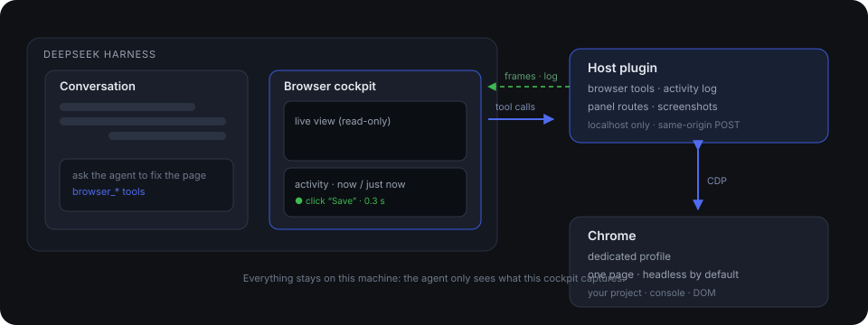

# 浏览器驾驶舱（Browser cockpit）

[](https://github.com/deepseek-ai/deepseek-harness)

**给 [DeepSeek Harness](https://github.com/deepseek-ai/deepseek-harness) 智能体用的实时浏览器驾驶舱。**
智能体驾驶一个真实的 Chrome，你在对话旁边看着同一个页面、以及它做的每一步。

[English](README.md) · [架构图](docs/architecture.svg)

## 为什么做

智能体读代码很在行，但看不到跑起来的界面。这个插件给它一个自己控制的 Chrome 页面：打开、读结构、点击、输入、切视口、截图；同时给你一个驾驶舱：右侧栏的实时画面、带缩略图的逐步操作记录、输入框上方「现在在做什么」的小胶囊。不用再来回截图、贴图。

## 功能

- **15 个浏览器工具**：打开、读页面、等待、处理对话框、点击、悬停、拖动、输入、按键、滚动、执行脚本、读控制台、截图、切视口、关闭。
- **实时画面**：右侧栏与对话并排，约 1.3 秒刷新一次。
- **操作记录**：每一步的时间、耗时、结果、页面、新增报错，并附可放大的缩略图。
- **自动打开**：会话里第一次操作浏览器时右侧栏自动展开；关掉后由状态胶囊接管。
- **状态胶囊**：输入框上方显示「智能体正在：点击『保存』」或「刚刚：截图」，带缩略图和「查看画面」。
- **按会话过滤**：右侧栏和胶囊只显示当前会话的操作，加上你自己在面板里的操作；左侧面板保留完整历史。
- **真实输入**：点击和输入是浏览器级事件，React 状态、焦点、校验、悬浮表现和真人操作一致。
- **只在本机**：独立 Chrome 配置、回环地址上的面板路由、无遥测、无外部服务。

## 工作原理



Host 半边运行一个独立 Chrome，注册 `browser_*` 工具和回环 JSON 路由（`state`、`activity`、`frame.jpg`、`thumb`、`action`）。Client 半边是一个小 React 面板，轮询这些路由：注册左侧栏入口、右侧栏标签、会话标题栏图标和输入框胶囊。工具截图会作为持久附件进入对话，所以智能体能在对话里直接看到图片。

## 环境要求

- DeepSeek Harness `0.2.2-rc.x`（提供本插件使用的 Client 插槽与右侧栏标签 API 的版本）。
- DSH Web 界面（右侧栏标签和胶囊依赖它）。
- Node.js 22+（Host 使用内置 WebSocket；DSH Desktop 自带 Node 24）。
- Chrome、Edge 或 Brave。

## 安装

1. 克隆本仓库：

   ```bash
   git clone https://github.com/QinG1022/dsh-browser-cockpit.git
   ```

2. 在 DSH 打开 **插件 → 添加插件 → 本地目录**，选择克隆下来的文件夹。  
   或者让智能体用目录绝对路径安装（`plugin_manager install_bundle`）。
3. 打开左侧栏的 **浏览器**，或让智能体打开一个地址。
4. 如果左侧栏没有出现入口，刷新一次 DSH 窗口。

```text
插件 → 添加插件 → 本地目录 → <本仓库>
```

包没有发布到 npm（`"private": true`），从目录安装即可。

## 快速开始

```bash
# 在你的项目里
pnpm dev          # 终端会打印地址，例如 http://localhost:5173
```

然后对智能体说：

> 打开终端打印的地址（例如 `http://localhost:5173`），看看登录页。提交按钮如果错位就修一下。

`3000`、`5173`、`8080` 都只是例子。驾驶舱接受任意 URL 和端口，并且会记住你上次打开的地址，所以项目跑在 5173 或 8080 也不用每次重输。

右侧栏会带着实时页面自动展开；智能体读页面结构、点击、输入，最后带着截图和控制台报错回来。你可以关掉右侧栏继续对话——输入框上方的胶囊会继续提示。

## 驾驶舱界面

| 位置 | 内容 |
|---|---|
| **左侧栏 → 浏览器** | 完整驾驶舱：地址栏、打开/刷新、视口预设、实时画面，以及完整操作记录。适合自己动手操作。 |
| **右侧栏 → 浏览器标签** | 对话旁的紧凑驾驶舱：上方实时画面，下方当前会话的操作记录（带缩略图）。每个会话自动打开一次，也可以点标题栏图标打开。 |
| **会话标题栏图标** | 一键展开右侧栏标签。 |
| **输入框胶囊** | 右侧栏标签不可见时出现：「智能体正在：…」/「刚刚：…」、缩略图和「查看画面」。智能体开始操作时会自动展开右侧栏。 |

关掉右侧栏标签会被该会话记住，不会再次自动弹出，改由胶囊提示。手动打开（标题栏图标、「查看画面」或面板里的链接）会重新启用自动打开。

## 智能体工具

| 工具 | 用途 |
|---|---|
| `browser_open` | 打开地址并返回页面结构、可见文本和截图；首次调用会启动 Chrome。 |
| `browser_snapshot` | 重新读取页面：带控件状态的引用、可见文本、截图；`interactiveOnly` 返回紧凑操作列表。 |
| `browser_click` | 按 ref/选择器点击元素，或用 x/y 点击视口坐标；支持左/右/中键和 1–3 次点击。 |
| `browser_hover` | 把鼠标移到元素上，展开菜单或提示。 |
| `browser_drag` | 用左键把一个元素拖到另一个元素。 |
| `browser_type` | 聚焦输入框、替换内容，可选回车提交。 |
| `browser_key` | 发送按键或组合键（`Enter`、`Tab`、`Control+A` 等）。 |
| `browser_wait_for` | 等待可见文本、选择器、URL 或网络空闲后再操作。 |
| `browser_handle_dialog` | 在 `dialogBehavior` 为 `manual` 时处理等待中的 alert/confirm/prompt。 |
| `browser_scroll` | 滚动页面，或把元素滚入视野。 |
| `browser_eval` | 在页面里执行 JavaScript 并返回 JSON 值。 |
| `browser_console` | 最近的控制台消息、未捕获异常和失败请求。 |
| `browser_screenshot` | 截取视口或整页图片。 |
| `browser_resize` | 切换视口尺寸（320–3840 × 240–2160）。 |
| `browser_close` | 关闭浏览器；下次工具调用会重新启动。 |

## 配置

可以在插件的 bundle 行上设置（同名的行覆盖会替换整个 `config`）：

```yaml
- id: browser-cockpit
  name: 'dsh-browser-cockpit'
  config:
    browserPath: 'C:\Program Files\Google\Chrome\Application\chrome.exe'
    headless: false      # 显示 Chrome 窗口
    width: 1440
    height: 900
    profileDir: 'C:\Users\you\.dsh\browser-control\profile'
```

| 选项 | 默认值 | 说明 |
|---|---|---|
| `browserPath` | 自动查找 | Chrome/Edge/Brave 可执行文件。 |
| `headless` | `true` | `false` 时显示浏览器窗口。 |
| `width`、`height` | `1440`、`900` | 初始视口。 |
| `profileDir` | `~/.dsh/browser-control/profile` | 持久化的 Chrome 配置目录。 |
| `dialogBehavior` | `dismiss` | JavaScript alert/confirm/prompt 的处理方式：`dismiss`、`accept` 或 `manual`；`beforeunload` 始终接受。 |

环境变量回退：`DSH_BROWSER_PATH`、`DSH_BROWSER_PROFILE`。

## 安全与隐私

- 受控 Chrome 使用**独立配置目录**，不读取你日常浏览器的 Cookie；该目录会持久保存，因此你在其中登录过的站点重启后仍然有效。
- 面板路由只由本地 Harness Web 服务提供（`127.0.0.1`）。`GET state/activity/frame/thumb` 在回环地址上不需要认证；`POST action` 要求同源 JSON 请求。不要把 Harness 端口暴露到网络。
- 打开 Harness 自身地址时，插件会用进程 token 让受控 Chrome 登录一次，然后从地址栏移除 token；token 不会写进操作记录。
- 智能体可以在受控页面里执行任意 JavaScript（`browser_eval`），也可以打开 `file://` 地址。只把它用在你打算检查的页面上。
- 无遥测；除了你让它打开的页面，不会发起外部请求。
- 操作记录和缩略图保存在 Host 内存里（60 条、30 张缩略图），Host 插件重载或应用重启后清空。磁盘截图位于系统临时目录（`dsh-browser-control`），只保留最近 40 张。

## 已知限制

- 每个 Harness 进程只控制一个页面。
- 不跟随页面打开的新标签页/新窗口；跨域 iframe 内部无法检查。
- 拖拽使用鼠标按键事件；原生 HTML5 drag-and-drop 可能不会触发 drag 事件。
- Chrome 原生 `<select>` 弹层和系统对话框不在页面里，无法驱动。JavaScript alert/confirm/prompt 已处理：默认取消，`dialogBehavior: accept` 接受，`manual` 时用 `browser_handle_dialog` 回答。
- 右侧栏标签只在对话视图显示；切到其他主面板时右栏隐藏（回来后会恢复）。
- 操作记录是整个进程共享的（浏览器只有一个）：左侧面板显示全部，右侧栏和胶囊只显示归属当前会话的操作；面板/命令行触发的操作没有会话归属，只出现在左侧面板。
- 右侧栏标签每个会话自动打开一次；被你关掉的会话不会再自动弹出。
- 智能体看到的截图长边上限 1600px，活动缩略图 480px。

## 开发

```text
index.js            Host 插件：一个 BrowserSession、工具、路由
client.js           Client 插件：侧栏入口、面板、右侧栏标签、标题栏图标、状态胶囊
lib/browser.js      CDP 页面：启动、导航、快照、点击、输入、截图
lib/cdp.js          最小 WebSocket CDP 传输（Node 内置 WebSocket）
lib/tools.js        工具定义与活动埋点
lib/routes.js       回环面板路由（state、frame、activity、thumb、action）
lib/activity.js     内存操作日志与缩略图
lib/targets.js      URL 规范化和 Harness 一次性登录
dev-check/          针对真实 Chrome 的独立冒烟脚本
docs/               架构图
```

- 无构建步骤、无 npm 依赖。
- `node --check <file>` 检查语法。
- `node dev-check/smoke.mjs` 会用无头 Chrome 打开 `dev-check/test.html`，跑一遍导航、快照、点击、输入、控制台、截图和视口切换。`node dev-check/look.mjs <url> [out.png]` 可以打开任意地址并打印页面摘要。
- 改 **Host** 文件后需要卸载再重装 bundle（否则 Loader 会沿用旧的模块代次）；改 **Client** 文件后刷新 DSH 窗口；插件元数据变动需要重启应用。

## 排查

| 现象 | 处理 |
|---|---|
| `no Chrome or Edge executable was found` | 安装 Chrome/Edge，或配置 `browserPath`。 |
| `the browser exited immediately` | 上次异常退出遗留的受控 Chrome 占用了 profile。新版会尝试接管并保留原页面；仍失败时，关闭使用该 profile 的 Chrome，或换 `profileDir`。 |
| `timed out waiting for the browser debugging port` | 关掉使用该配置目录的遗留 Chrome 窗口。 |
| 安装后侧栏没有入口 | 刷新一次 DSH 窗口。 |
| 右侧栏标签不自动打开 | 这个会话里你关过它（设计如此）；用标题栏图标或胶囊「查看画面」。 |
| 打开 Harness 地址是空白或 401 | 从驾驶舱面板重新打开；插件会自动登录。 |

## 贡献

欢迎提 [issue](https://github.com/QinG1022/dsh-browser-cockpit/issues) 或 PR。请保持插件只在本机运行（无遥测、无外部请求）、把可见文案同时加到 `client.js` 的中英文字典里，并在验证时避免截取任何人的私有 DSH 界面。

## 许可

[MIT](LICENSE)

[](https://github.com/deepseek-ai/deepseek-harness)
